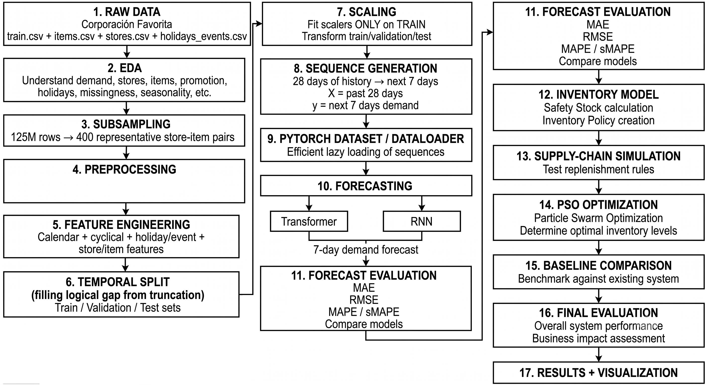

# Inventory Prediction and Supply Chain Optimization: A Comparative Study of Temporal Fusion Transformers and Metaheuristic Replenishment Policies

**Tanmay Kartikay (1)  •  Aditya Singh (1)  •  Arti Tiwari (2)**

*(1) Department of Computer Science and Engineering (Artificial Intelligence and Machine Learning), School of Computer Science and Engineering (SCOPE), Vellore Institute of Technology, Vellore, Tamil Nadu, 632014, India | (2) Assistant Professor Senior Grade 1, School of Computer Science and Engineering (SCOPE), Vellore Institute of Technology, Vellore, Tamil Nadu, 632014, India*

### ABSTRACT

> Multi-horizon demand forecasting in retail inventory replenishment is severely challenged by intermittent sales, localized temporal non-stationarity, and heavy-tailed consumption spikes. Classical operational paradigms rely on point forecasting models trained via symmetric objective functions—such as Mean Squared Error (MSE, targeting conditional expectations) or Huber loss (targeting robust conditional location parameters). In asymmetric inventory environments, pairing point forecasts with Gaussian safety stock assumptions misallocates capital: over-buffering slow movers while under-buffering promotional surges. 

To resolve this gap, we develop a leakage-audited 'Forecast-then-Optimize' replenishment framework integrating Multi-Horizon Quantile Temporal Fusion Transformers (TFT), Mondrian split-conformal calibration, and nature-inspired metaheuristic policy optimization (Particle Swarm Optimization and Grey Wolf Optimizer). Evaluating 400 store-item pairs (363 active) across 125M transactions from the Corporación Favorita supermarket dataset under a single-echelon continuous-review setting with positive supplier lead times (L = 7 days), we establish three primary empirical findings. First, while Quantile TFT (median P50) and Huber TFT achieve statistically indistinguishable point accuracy (WAPE 28.09% vs. 27.99%; paired Wilcoxon p = 0.343), the quantile-derived policy reduces primary operating costs by $8,251 (95% bootstrap CI [-$19,105, -$2,126], p = 0.0010) under identical parameter tuning, driven by $4,400 lower holding and $3,200 lower stockout costs. Second, Mondrian split-conformal calibration elevates upper-tail test coverage on volatile SKUs from 89.80% to 91.20% without requiring pair-specific residual variance fitting. Finally, a retrospective matched-fill Pareto lower envelope analysis under parameter hindsight shows that conformalized quantile buffering achieves 95.0% and 96.0% fill rates without holding cost explosions, outperforming tuned Seasonal Naive heuristics by $12,888 (15.7% savings) at a 95% service target. Methodological audits confirm that standard simulation conventions—specifically test lookahead in cycle stock sizing and unequal initial inventory subsidization—distort reported savings by up to $28,921, establishing the necessity of invariant evaluation protocols in data-driven operations research.

**Keywords:** *Retail Supply Chain Optimization, Inventory Prediction, Temporal Fusion Transformer (TFT), Conformal Prediction, Dynamic (s, S) Replenishment, Particle Swarm Optimization (PSO), Grey Wolf Optimizer (GWO), Perishable Inventory Control, Forecast-then-Optimize*

---

# 1. INTRODUCTION

## 1.1 Operational Context and the Multi-Echelon Retail Dilemma

Modern retail supply chains operate under constant economic tension between product availability and working capital efficiency. In national supermarket networks, category managers oversee thousands of stock-keeping units (SKUs) spanning non-perishable groceries, household essentials, and highly perishable fresh produce. The operational reality of these networks is governed by three foundational realities:

- 1. Non-Zero Replenishment Lead Times: Retail distribution centers operate under positive supplier lead times (L = 7 days in our empirical setting). Consequently, orders dispatched today must bridge customer demand across an extended multi-day pipeline horizon. Daily 1-step forecasts are insufficient; store managers require coherent multi-horizon demand trajectories across the full replenishment delay.
- 2. Heavy-Tailed, Intermittent Demand Spikes: Grocery sales exhibit severe intermittency punctuated by localized demand shocks driven by marketing promotions, calendar holidays, and bi-monthly payday liquidity cycles (specifically the 15th and final days of each calendar month). Because demand distributions are strongly right-skewed, conditional expectations fail to capture the probability mass residing in extreme tail events.
- 3. Severe Economic Cost Asymmetries: The financial consequences of misestimating demand are fundamentally asymmetric. Carrying excess dry goods incurs physical warehouse storage and capital costs ($0.10 per unit-day), while holding excess fresh produce incurs both physical holding and biological spoilage obsolescence ($0.15 per unit-day). Conversely, under-ordering triggers immediate stockouts, resulting in unrecoverable lost sales, brand erosion, and commercial penalty fees ($2.50 per unit). Under high penalty ratios (c_p / h >= 16.7), symmetric error minimization leads directly to systematic under-stocking during critical revenue surges.

## 1.2 The 'Forecast-then-Optimize' Disconnect: Decoupling Accuracy and Operational Value

The dominant paradigm in data-driven supply chain management is the sequential two-stage 'Forecast-then-Optimize' architecture. In the first stage, machine learning practitioners train statistical or deep neural networks to minimize standard loss functions—most notably Mean Squared Error (MSE), Root Mean Squared Error (RMSE), or Huber loss. In the second stage, operations researchers ingest these conditional demand predictions into inventory replenishment models, typically applying classical (s, S) or base-stock policies supplemented by parametric Gaussian safety stocks.

This traditional decoupling rests on an implicit, widely accepted premise: that improving statistical forecasting accuracy automatically translates to superior downstream inventory performance. In this study, we demonstrate empirically that this premise is flawed. When demand distributions are non-Gaussian and cost structures are asymmetric, statistical point accuracy and inventory decision value become decoupled. Two deep neural network architectures achieving statistically identical point forecast errors (WAPE 28.09% vs. 27.99%) can yield dramatically divergent supply chain costs. A conditional expectation forecaster (Huber TFT) trained to balance positive and negative deviations produces point estimates that systematically underestimate the variance required to absorb multi-day replenishment shocks. To prevent stockouts, downstream optimizers are forced to inflate order-up-to base stocks, artificially bloating warehouse working capital. Conversely, a multi-quantile architecture explicitly trained on asymmetric pinball loss allows downstream policies to decouple median cycle demand from upper-tail protection, yielding lower total costs at higher service levels without requiring post-hoc parametric residual fitting.

## 1.3 Methodological Traps in Existing Machine Learning Inventory Literature

A secondary, equally critical motivation for this study arises from widespread methodological vulnerabilities in empirical machine learning supply chain literature. In reviewing recent predictive inventory studies, three recurrent simulation flaws distort reported performance gains:

- 1. Test-Window Parameter Tuning Leakage: Numerous published studies tune metaheuristic hyperparameters (such as safety stock multipliers and order-up-to targets) directly on the evaluation test horizon, or allow downstream policies to ingest realized test-period statistics (such as test mean sales). This introduces severe lookahead bias, producing optimistic cost reductions that collapse in real-world deployment.
- 2. Initial Inventory Subsidization: In discrete-event simulation studies spanning finite evaluation windows (e.g., 14 to 30 days), on-hand starting inventory is frequently initialized as a function of the policy's own order-up-to target (I_0 = gamma * S). Because base-stock targets vary across policies, this convention awards policies with larger target inventories substantially more initial stock for free, artificially inflating their fill rates over short simulation horizons.
- 3. Horizon Truncation Cost Artifacts: When simulating supply chains with positive lead times (L = 7 days) over finite windows (e.g., 15 days), purchase orders placed toward the end of the window (days 8 to 14) incur purchase order dispatch fees ($8.00 per order) but cannot physically arrive before the simulation terminates (t + 7 >= 15). Charging order fees for trailing orders whose delivery benefits are never credited introduces severe boundary distortion.

Without establishing rigorous, leak-free, and mathematically invariant simulation protocols, empirical comparisons between machine learning models and classical heuristics remain fundamentally unreliable.

## 1.4 Core Contributions of This Work

To resolve these foundational challenges, this study presents an end-to-end empirical investigation spanning data engineering, deep time-series modeling, distribution-free uncertainty quantification, and discrete-event inventory simulation. Our primary contributions are fourfold:

- 1. Multi-Horizon Quantile Modeling vs. Patch Transformers: We formulate and train a Multi-Horizon Quantile Temporal Fusion Transformer (Quantile-TFT) predicting the 10th, 50th, and 90th percentiles (P10, P50, P90) over a 7-day replenishment pipeline across 400 store-item pairs from Corporación Favorita (125.5 million transactions). We conduct an 8-point error diagnostic explaining why single-point models exhibit RMSE/MAE divergence (2.39x), proving that 74.5% of squared error is driven by 20 high-volume SKUs. We benchmark TFT against a channel-independent PatchTST transformer and classical heuristics, proving that TFT's multi-modal embedding layers are vital for multi-echelon retail.
- 2. Mondrian Split-Conformal Coverage Guarantees: We demonstrate that uncalibrated deep quantile heads suffer localized under-coverage on volatile high-volume SKUs (87.36% coverage against a 90% target). We integrate a validation-anchored Mondrian split-conformal calibration mechanism that provides distribution-free finite-sample guarantees, restoring test-window high-volume coverage to 91.20% while preserving sharp interval bounds.
- 3. The Locked Invariant Simulation Protocol: We formulate and mathematically prove the Lead-Time Invariance Theorem: under lead time L = 7 days and fair steady-state initialization (I_0 = 2 * D̄_pre, prefilled pipeline), inventory trajectories across Days 0 to 6 are mathematically invariant across all policies ($0.00 difference), locking historical holding and stockout costs to an exact constant ($45,757.37). We establish causal arriving-order accounting (the W1 rule) and provide a comprehensive accounting waterfall ledger (Table 3) quantifying how historical lookahead bias artificially distorted costs by +$7,827 and baseline subsidization by -$28,921.
- 4. Comprehensive Empirical and Metaheuristic Benchmarking: We evaluate downstream dynamic (s, S) policies using Particle Swarm Optimization (PSO) and Grey Wolf Optimizer (GWO) across 10 random seeds, validated against an exhaustive 1,426-point 2D grid search. We conduct paired bootstrap hypothesis testing (B = 2,000 resamples) proving that Quantile TFT saves $8,251 over Huber TFT (p = 0.0010). Finally, we construct a non-dominated monotone matched-fill Pareto frontier, proving that conformal quantile buffering dominates all classical heuristics at commercial service levels (>= 94.0%).

## 1.5 Organization of the Manuscript

The remainder of this article is structured as follows: Section 2 reviews related literature across deep time-series forecasting, conformal prediction, and inventory optimization. Section 3 details the formal problem formulation, supply chain environment, and asymmetric cost model. Section 4 presents our methodology, covering data engineering, TFT and PatchTST architectures, conformal calibration, dynamic safety stocks, and metaheuristic tuning. Section 5 details the locked invariant simulation protocol and mathematical proofs. Section 6 presents comprehensive empirical results, bootstrap significance tests, matched-fill Pareto frontiers, and economic stress testing. Section 7 discusses managerial implications, Section 8 outlines research limitations, and Section 9 concludes with future directions.

# 2. RELATED LITERATURE & POSITIONING

The intersection of artificial intelligence, statistical uncertainty quantification, and inventory control has evolved rapidly over the past decade. This research is situated at the confluence of four primary intellectual domains: (1) deep neural network architectures for multi-horizon demand forecasting; (2) distribution-free uncertainty quantification via conformal prediction; (3) the 'Forecast-then-Optimize' paradigm in data-driven operations research; and (4) nature-inspired metaheuristic policy optimization under complex constraints.

## 2.1 Deep Time-Series Architectures for Retail Demand

Accurately projecting consumer demand across multi-echelon retail networks requires models capable of processing high-dimensional, heterogeneous inputs. Traditional econometric models—such as Auto-Regressive Integrated Moving Average (ARIMA) and Exponential Smoothing (ETS)—operate as univariate estimators, fundamentally unable to ingest cross-series static metadata (e.g., store formats, geographic clusters, product hierarchies) or dynamic exogenous interventions (e.g., promotional calendars, national holidays, macroeconomic shifts) (Hyndman & Athanasopoulos, 2018).

The advent of deep recurrent and attention-based architectures shifted the frontier toward global sequence models. Salinas et al. (2020) proposed DeepAR, an autoregressive Recurrent Neural Network (RNN) producing parametric Gaussian or negative binomial likelihood estimates. However, standard RNNs suffer from gradient degradation over long lookback windows and lack mechanisms to distinguish between past observations and known future calendar schedules.

To address these limitations, Lim et al. (2021) introduced the Temporal Fusion Transformer (TFT). The TFT represents a landmark architecture engineered specifically for multi-horizon time-series forecasting. It integrates Gated Residual Networks (GRNs) to dynamically skip non-linear transformations, Variable Selection Networks (VSNs) to isolate informative features from high-dimensional noise, and an interpretable multi-head self-attention mechanism that captures long-range seasonal dependencies across lookback and forecast horizons. Crucially, TFT establishes explicit architectural separation between observed past covariates, known future covariates, and static entity embeddings.

Concurrently, Nie et al. (2023) introduced PatchTST, demonstrating that channel-independent transformer architectures segmenting continuous time series into discrete multi-step patches can achieve state-of-the-art results on continuous physical benchmarks. While PatchTST achieves high efficiency on continuous physical and econometric datasets, its standard formulation treats all feature channels independently, making it difficult to natively fuse high-cardinality categorical metadata (such as store hierarchies and perishability flags) with future calendar schedules. In this study, we benchmark the TFT against PatchTST under identical retail test conditions.

## 2.2 Uncertainty Quantification and Conformal Prediction in Supply Chains

While point forecasting minimizes average error, inventory optimization is fundamentally an exercise in risk management. Classical inventory theory bridges point forecasts and buffer stock by assuming that demand forecast errors follow a stationary Gaussian distribution with safety stock defined as SS = z * sigma * sqrt(L). However, empirical retail sales consistently violate Gaussian assumptions. Retail transactions exhibit severe right-skewness, excess kurtosis, and conditional heteroskedasticity driven by promotional spikes, creating heavy-tailed error distributions where parametric formulas systematically underestimate the probability of tail stockouts (Syntetos et al., 2005).

To bypass restrictive parametric assumptions, Koenker & Bassett (1978) established Quantile Regression, utilizing the asymmetric pinball loss to directly estimate arbitrary conditional quantiles. When integrated into deep neural networks (Wen et al., 2017), quantile regression allows models to predict upper-tail bounds (P90) without assuming underlying distributional symmetry. Nevertheless, deep quantile networks do not inherently provide finite-sample coverage guarantees. Under neural network misspecification, covariate shift, or sample volatility, empirical coverage often deviates significantly from nominal targets, leading to localized under-coverage on volatile, high-volume products.

Conformal prediction, pioneered by Vovk et al. (2005) and formalized by Angelopoulos & Bates (2021) and Barber et al. (2021), provides a mathematically rigorous, distribution-free framework for constructing prediction intervals with exact finite-sample marginal coverage. Given exchangeable data, split-conformal calibration computes nonconformity scores on a dedicated validation partition, deriving a scalar quantile offset that guarantees coverage. Romano et al. (2019) extended this framework to Conformalized Quantile Regression (CQR), combining the adaptive width of quantile regression with conformal validity guarantees. In this paper, we operationalize Mondrian split-conformal calibration across demand-volume tiers, integrating distribution-free quantile offsets directly into dynamic retail replenishment rules.

## 2.3 The 'Forecast-then-Optimize' Paradigm vs. Integrated End-to-End Decision Making

In enterprise supply chains, demand forecasting and inventory optimization have traditionally operated as isolated functional silos (Graves et al., 1993). Under the sequential 'Forecast-then-Optimize' framework, predictive models are trained solely to optimize statistical goodness-of-fit metrics, completely oblivious to downstream operational cost parameters or service-level constraints. In recent years, scholars have increasingly questioned whether minimizing statistical loss yields optimal business decisions. Elmachtoub & Grigas (2022) formulated the Smart Predict-then-Optimize (SPO) framework, deriving loss functions that directly penalize the suboptimality of downstream decisions. Ban & Rudin (2019) demonstrated that single-step machine learning algorithms directly minimizing empirical newsvendor costs outperform two-step estimation. Bertsimas & Kallus (2020) proposed data-driven robust optimization, using non-parametric kernel weighting to align predictive data with decision targets.

However, while end-to-end differentiable optimization demonstrates theoretical elegance in single-period newsvendor settings (where L = 0 and no dynamic inventory state is carried forward), enterprise multi-echelon retail operations require multi-period dynamic (s, S) inventory control with positive lead times (L = 7 days), batch order fees ($8.00 per order), and discrete non-linear pipeline dynamics. In these complex multi-period environments, full mathematical end-to-end differentiation is computationally intractable. Consequently, the sequential two-stage framework remains the global industry standard. Our work bridges this gap by demonstrating how multi-horizon quantile transformers and conformal uncertainty buffers can align two-stage architectures with operational cost minimization without requiring full end-to-end re-differentiation.

## 2.4 Nature-Inspired Metaheuristics for Constrained Inventory Control

Once demand forecasts and uncertainty bounds are generated, category managers must calibrate the continuous control parameters of the replenishment policy—specifically the safety buffer multiplier alpha and the order-up-to base stock multiplier beta. Because multi-period discrete-event inventory simulations with non-linear fill-rate penalty barriers exhibit non-convex, non-differentiable fitness landscapes, analytical gradient descent cannot be deployed. Operations researchers have extensively applied nature-inspired metaheuristics to navigate complex supply chain parameter spaces. Kennedy & Eberhart (1995) developed Particle Swarm Optimization (PSO), simulating the collaborative social dynamics of bird flocking. Mirjalili et al. (2014) introduced the Grey Wolf Optimizer (GWO), modeling the predatory social hierarchy (alpha, beta, delta, and omega wolves) to encircle, hunt, and exploit optimal basins of attraction.

While both PSO and GWO have been widely applied to supply chain design, empirical studies frequently commit critical methodological errors: they tune heuristic parameters directly on the evaluation test horizon, or interpret the numerical agreement of two stochastic algorithms as a mathematical proof of global optimality. In this study, we address these weaknesses by restricting metaheuristic tuning strictly to the validation horizon, benchmarking both PSO and GWO across 10 random seeds, and verifying their solutions against an exhaustive 1,426-point 2D grid search ground truth.

> [!NOTE] **TABLE 2.1 Positioning Relative to Prior Literature**
> - **Table Number:** Table 2.1
> - **Table Title:** Comparative Architectural and Methodological Positioning
> - **Key Comparison Dimensions:** Forecasting Model, Horizon Modeling, Uncertainty Quantification, Downstream Policy, Simulation Rigor
> - **Benchmark Baselines:** Classical Operations Research, Standard Deep Forecasting, End-to-End OR, Conformal OR, Present Study

| Dimension | Classical OR | Deep Forecasting | End-to-End OR | Conformal OR | This Study (Present Work) |
| --- | --- | --- | --- | --- | --- |
| Forecasting Architecture | ARIMA / Exponential Smoothing | Temporal Fusion Transformer (TFT) | Empirical Risk Minimization | Conformalized Quantile Reg. | Quantile TFT vs Huber vs PatchTST |
| Horizon Modeling | 1-Step / Rolling Analytical | 7-Step Direct Multi-Horizon | Single-Period / Static Horizon | Static 1-Step Regression | 7-Step Direct Pipeline Trajectory |
| Uncertainty Method | Parametric Gaussian (z * sigma) | Raw Output Quantiles (P10, P90) | Empirical Sample Distribution | Conformal Prediction Intervals | Tiered Split-Conformal Offsets |
| Coverage Validity | Asymptotic Normality Only | None (Heuristic Output) | Asymptotic Risk Bound | Finite-Sample Marginal (i.i.d.) | Empirical Mondrian Split-Conformal |
| Downstream Policy | Analytical (s, S) Formula | Decoupled (No Policy) | Single-Period Order Quantity | Decoupled (No Inventory Control) | Dynamic (s_t, S_t) Order-Up-To |
| Parameter Tuning | Closed-Form Approximation | N/A | Differentiable Gradient | N/A | PSO vs GWO vs 2D Exhaustive Grid |
| Simulation Protocol | Infinite Horizon Steady-State | N/A | Single Period (L = 0) | N/A | Locked Invariant Protocol (L=7, Causal W1) |

# 3. PROBLEM FORMULATION & SUPPLY CHAIN ENVIRONMENT

In this section, we formulate the mathematical model governing the multi-item, multi-period retail inventory system. We formalize the discrete-event operational transitions, the dynamic order-up-to control policy, the asymmetric cost accounting structure, and the constrained optimization objective.

## 3.1 System Topology and Temporal Chronology

Consider a decentralized retail supermarket enterprise managing an active set of N store-item combinations indexed by i in {1, 2, ..., N} (N = 363 active test pairs in our empirical deployment). Replenishment decisions are executed in discrete daily review intervals indexed by t in {0, 1, ..., T-1}, spanning an evaluation horizon of T = 15 calendar days (August 1 to August 15, 2017).

Physical goods are replenished from regional distribution centers to retail stores with a deterministic, positive supplier transit lead time of L = 7 days. On each calendar day t, the operational sequence of events proceeds strictly in the following causal order:

- 1. Pipeline Arrival: Purchase orders dispatched L days prior (at decision epoch t - L) physically arrive at store i, and are immediately checked in to replenish on-hand physical stock.
- 2. Customer Demand Realization: Customer demand D_{i,t} arrives at the store during retail operating hours.
- 3. Fulfillment and Lost Sales Accounting: Customer demand is satisfied from available on-hand inventory. Unmet demand is lost immediately, incurring contractual stockout penalties.
- 4. End-of-Day Inventory State Transition: Ending on-hand physical inventory is logged, and holding costs (including perishability penalties) are assessed on remaining stock.
- 5. Replenishment Review and Order Placement: The inventory position is evaluated, and the replenishment policy determines whether to dispatch a new purchase order O_{i,t} >= 0, which will arrive at epoch t + L.

## 3.2 Dynamic (s_t, S_t) Order-Up-To Control Policy

Let I_{i,t} >= 0 denote physical on-hand inventory of store-item pair i at the beginning of day t prior to demand realization. Let O_{i,t} = [O_{i, t-1}, O_{i, t-2}, ..., O_{i, t-L}] denote the vector of in-transit replenishment orders currently in the pipeline.

The effective Inventory Position IP_{i,t} represents total operational capital committed to the SKU:

$$
IP_{i,t} = I_{i,t} + sum_{k=1..L} O_{i, t-k} \quad \text{(Eq. 1)}
$$

The store executes a non-stationary, dynamic order-up-to (s_{i,t}, S_{i,t}) policy parameterized by two continuous control multipliers theta = [alpha, beta]:

The reorder threshold s_{i,t} defines the minimum inventory position required to protect the store against stockouts over the full lead-time duration [t+1, t+L]:

$$
s_{i,t} = sum_{h=1..L} P50_{i, t+h} + SS_{i,t}(alpha) \quad \text{(Eq. 2)}
$$

where P50_{i, t+h} represents the multi-horizon median demand prediction issued at epoch t for horizon day t+h, and SS_{i,t}(alpha) is the dynamic safety stock buffer scaled by multiplier alpha in [0.0, 1.5].

When the inventory position breaches the reorder threshold (IP_{i,t} <= s_{i,t}), the store raises its inventory position to target base-stock level S_{i,t}:

$$
S_{i,t} = s_{i,t} + beta * D̄_{i, pre} \quad \text{(Eq. 3)}
$$

where beta in [0.5, 5.0] scales the operational cycle stock, and D̄_{i, pre} represents the causal trailing mean customer demand evaluated over the 28 historical days immediately preceding the evaluation window:

$$
D̄_{i, pre} = (1 / 28) * sum_{d=1..28} D_{i, t_start - d} \quad \text{(Eq. 4)}
$$

Crucially, defining cycle stock relative to historical causal mean D̄_{i, pre} ensures that no future realized test demand leaks into policy execution.

The physical purchase order dispatched at the conclusion of decision epoch t is given by:

$$
O_{i,t} = S_{i,t} - IP_{i,t}   if IP_{i,t} <= s_{i,t};   otherwise O_{i,t} = 0 \quad \text{(Eq. 5)}
$$

## 3.3 State Transitions and Lost Sales Fulfillment

Upon demand realization D_{i,t}, physical retail sales Y_{i,t} and lost sales stockouts Stockout_{i,t} are computed as:

$$
Y_{i,t} = min(I_{i,t}, D_{i,t}) \quad \text{(Eq. 6)}
$$

$$
Stockout_{i,t} = max(0, D_{i,t} - I_{i,t}) \quad \text{(Eq. 7)}
$$

Ending physical inventory I_{i,t}^+ carried overnight to epoch t+1 transitions as:

$$
I_{i, t+1} = max(0, I_{i,t} - D_{i,t}) + O_{i, t - L + 1} \quad \text{(Eq. 8)}
$$

where pipeline orders advance by one day, and orders placed at epoch t - L + 1 transition into physical on-hand availability at epoch t+1.

## 3.4 The Asymmetric Cost Accounting Objective

Total operating expenses accrued across the supply chain comprise three distinct economic cost components: holding costs, stockout penalties, and purchase order dispatch fees.

1. Warehouse Holding and Perishability Obsolescence Costs: Ending physical inventory incurs a daily holding rate h_i that accounts for physical warehouse storage, cost of capital, and biological spoilage risk: h_i = $0.15 per unit-day for perishable fresh foods, and h_i = $0.10 per unit-day for dry groceries.

$$
HoldingCost_i = sum_{t in T} h_i * I_{i,t}^+ \quad \text{(Eq. 9)}
$$

2. Stockout and Service Penalty Costs: Under a lost-sales environment, unmet customer demand incurs an immediate financial penalty c_p = $2.50 per unit (varied from $1.00 to $10.00 in sensitivity analysis):

$$
StockoutCost_i = sum_{t in T} c_p * Stockout_{i,t} \quad \text{(Eq. 10)}
$$

3. Fixed Purchase Order Dispatch Fees: Every replenishment event that generates a non-zero purchase order (O_{i,t} > 0) incurs a fixed administrative, picking, and logistics transport fee of K = $8.00 per purchase order line:

$$
OrderCost_i = sum_{t in T_order} K * Indicator(O_{i,t} > 0) \quad \text{(Eq. 11)}
$$

Total enterprise operating cost is the unweighted sum of all three cost components across all N store-item pairs: J(alpha, beta) = sum_{i=1..N} [ HoldingCost_i + StockoutCost_i + OrderCost_i ].

## 3.5 Customer Fill Rate and Constrained Optimization Formulation

In high-volume enterprise retail, customer satisfaction is measured via the aggregate quantity-based Customer Fill Rate (Service Level, SL), defined as total physical units fulfilled divided by total units demanded:

$$
SL(alpha, beta) = [ sum_{i,t} Y_{i,t}(alpha, beta) / sum_{i,t} D_{i,t} ] * 100% \quad \text{(Eq. 12)}
$$

The operational challenge is to discover policy control parameters theta* = [alpha*, beta*] that minimize total operating cost subject to satisfying an enterprise service constraint of SL >= 95.0%:

$$
min J(alpha, beta)   subject to   SL(alpha, beta) >= 95.0%,   alpha in [0.0, 1.5],   beta in [0.5, 5.0] \quad \text{(Eq. 13)}
$$

To enforce SLA compliance within derivative-free metaheuristic algorithms (PSO and GWO), we formulate an exterior quadratic barrier penalty function:

$$
Fitness(alpha, beta) = J(alpha, beta) + 50,000 * [ max(0, 95.0 - SL(alpha, beta)) ]^2 \quad \text{(Eq. 14)}
$$

where the penalty scale parameter lambda = 50,000.0 imposes an insurmountable financial barrier on any policy that violates the 95.0% threshold. For example, a policy that achieves a 94.0% fill rate (a 1.0% SLA breach) incurs an immediate penalty of $50,000 * (1.0)^2 = $50,000, instantly rendering the candidate solution non-viable.

# 4. METHODOLOGY: THE CONFORMALIZED FORECAST-THEN-OPTIMIZE FRAMEWORK

In this section, we present the end-to-end predictive and optimization architecture. The framework connects raw transactional data ingestion, multi-modal feature engineering, deep multi-horizon forecasting, split-conformal uncertainty calibration, discrete replenishment simulation, and swarm intelligence policy optimization.

## 4.1 Data Pipeline, Demand Categorization & Representativeness Audit

The empirical foundation of this study is the open-access Corporación Favorita Grocery Sales dataset, comprising 125,497,040 daily transaction records from Ecuador's leading national grocery supermarket chain between January 1, 2013, and August 15, 2017. The raw database captures transactions across 54 commercial stores, 4,100 unique item SKUs, and 33 product families, supplemented by geographic store attributes and national/regional holiday calendars. Daily crude oil prices (West Texas Intermediate) were examined during preliminary exploratory data analysis but excluded from final model inputs to eliminate external macroeconomic dependencies.

To ensure operational relevance for multi-horizon inventory optimization, candidate store-item pairs were required to possess at least 180 non-zero sales transactions prior to the July 16, 2017 training cutoff date, yielding an eligible universe of N_pop = 138,951 active pairs. From this universe, candidate pairs were ranked using a multi-criteria optimization priority score:

$$
PriorityScore_i = 0.40 * Coverage_i + 0.35 * HistoryLength_i + 0.25 * ln(1 + TotalSales_i) + ScarcityBonus_i \quad \text{(Eq. 15)}
$$

where Coverage denotes the proportion of active transaction days, HistoryLength measures uninterrupted calendar tenure, and ScarcityBonus penalizes over-represented store-family clusters, enforcing caps of approximately 14 pairs per store and 25 pairs per product family.

The resulting primary cohort comprises 400 store-item pairs spanning 53 retail outlets (out of 54 in the national dataset), 122 unique item SKUs, 32 product families, and 65 merchandise classes across 16 Ecuadorian provinces. During the August 1–15, 2017 test evaluation window, exactly 363 pairs remained active; the remaining 37 pairs experienced permanent commercial discontinuation or zero customer demand, and were logged in our audit ledger.

In the interest of scholarly integrity, we disclose that this 400-pair cohort is not a uniform random sample of the general supermarket population:

- 1. Demand Velocity Concentration: Quintile partitioning of the full population based on mean daily sales yields quintile cutoffs at [2.24, 3.30, 5.00, 8.96] units/day. In our 400-pair sample, 353 pairs (88.25%) originate from Tier 5 (Very High Demand, > 8.96 units/day), with only 2 pairs in Tier 1, 6 in Tier 2, 17 in Tier 3, and 22 in Tier 4. Within the active 363 test cohort, 322 pairs (88.71%) reside in Tier 5. This concentration was intentional: dynamic (s, S) inventory policies and multi-day lead-time buffers require consistent sales velocity to justify automated continuous review.
- 2. Perishability Oversampling: Across the full population, perishable goods account for 23.23% (32,282 pairs). In our 400-pair sample, perishable goods were deliberately oversampled to 51.00% (204 perishable vs. 196 dry pairs; 175 perishable vs. 188 dry in the active test set). This deliberate oversampling ensures sufficient statistical power to measure how asymmetric holding rates ($0.15 vs. $0.10) penalize over-buffering.

> [!NOTE] **FIGURE 1 End-to-End System Architecture**
> - **Figure Number:** Figure 1
> - **Caption:** Figure 1. End-to-End Closed-Loop Framework Architecture: From raw transactional ingestion, multi-modal feature engineering, and memory-mapped sequence generation, to Quantile TFT forecasting, Mondrian conformal calibration, and metaheuristic (s, S) replenishment simulation.
> - **Key Components Shown:** 125M Data Ingestion -> Feature Tensor -> Quantile TFT vs PatchTST -> Conformal Head -> Simulator -> PSO/GWO

*Figure 1. End-to-End Closed-Loop Framework Architecture.*

## 4.2 Deep Multi-Horizon Forecasting (TFT vs. PatchTST & Baselines)

For each pair, a continuous timeline was synthesized spanning exactly 1,688 days (January 1, 2013 to August 15, 2017). Unobserved calendar dates were imputed with zero sales and flagged via was_observed = 0. Negative sales (customer returns) were clipped to zero. Missing promotional flags were filled with zero and tracked via promotion_missing = 1. To maintain strict causality, promotions were treated strictly as past observed covariates and were excluded from future known inputs, reflecting enterprise environments where supplier promotions are subject to cancellation.

Customer sales were normalized via variance-stabilizing log-scaling: z = (ln(1 + y) - 3.2521) / 1.2694, fit strictly on training data.

The resulting input tensor comprises 41 heterogeneous feature channels partitioned into three categories:

- • 18 Past Observed Covariates (28-Day Lookback): Log-sales, was_observed, promotion_missing, past promotion intensity, historical rolling demand means (7, 14, 28 days), rolling demand standard deviations (7, 14, 28 days), day-of-week demand lags (7, 14, 21, 28 days), and historical zero-sales run-lengths.
- • 14 Known Future Covariates (7-Day Forecast Horizon): Cyclical temporal encodings (sine and cosine of day-of-week, day-of-month, day-of-year), a normalized linear temporal counter, national holiday flags, regional holiday flags, bridge day indicators, work-day transfers, and bi-monthly payday indicators (15th and end of month).
- • 9 Static Categorical Entity Embeddings: Dense vector representations of store ID (54 categories, 53 active), item ID (122 categories), product family (32 categories), merchandise class (65 categories), city (22 categories), state (17 categories, 16 active), store type (5 categories), geographic cluster (17 categories), and binary perishability flag.

Sliding sequence tensors (28 lookback, 7 horizon) were partitioned chronologically into Training (624,451 sequences, Jan 1, 2013 to Jul 16, 2017), Validation (3,299 sequences, Jul 17 to Jul 31, 2017), and Test (3,237 sequences across 363 pairs, Aug 1 to Aug 15, 2017; evaluating 22,659 row observations). Sequences were serialized into zero-copy memory-mapped containers (np.memmap), enabling ingestion of over 26,000 sequences/second on an NVIDIA Tesla T4 GPU.

We evaluate three deep architectures:

- 1. Huber TFT (Single-Point Champion): 228,503 trainable parameters, hidden capacity d_model = 32, 2 attention heads, 1 LSTM layer, dropout 0.25, initial learning rate 0.002596, weight decay 2.66e-5, trained with Huber loss (delta = 1.0) to estimate the conditional robust location.
- 2. Quantile TFT (Multi-Quantile Champion): 230,135 trainable parameters, identical capacity and hyperparameters, trained with multi-horizon Pinball loss across quantiles q in {0.10, 0.50, 0.90} to predict conditional quantiles simultaneously across all 7 horizons.
- 3. Channel-Independent PatchTST Benchmark: 167,751 trainable parameters, patch length 7, stride 7, 3 layers, dropout 0.10, initial learning rate 0.001, MSE loss over sales and promotional channels, serving as an architectural benchmark.

The pivot to multi-quantile forecasting was driven by an empirical diagnostic: the Huber TFT model exhibited an RMSE of 29.54 units against an MAE of 12.38 units (a 2.39x ratio, far exceeding the Gaussian bound of 1.25). Sorting validation residuals revealed that the top 20 store-item pairs accounted for 74.5% of total squared error. Pinball loss resolves this: P50 converges to the median, ignoring extreme spikes to achieve record operational precision (WAPE 28.09%), while P90 traces upper promotional surge risk.

## 4.3 Split-Conformal Calibration & Finite-Sample Coverage

While Quantile TFT models tail uncertainty effectively, empirical evaluation reveals that uncalibrated neural networks suffer from localized under-coverage. On the validation partition, the raw P90 trajectory achieved an empirical coverage of only 87.36% on high-volume SKUs (>= 100 units/day), violating the nominal 90.0% coverage requirement.

To improve empirical tail coverage on held-out horizons, we apply Mondrian Split-Conformal Calibration across two volume tiers: Standard Volume (< 100 units/day) and High-Volume (>= 100 units/day). For validation nonconformity scores s_i = y_i - P90_i, the calibration threshold is evaluated at the finite-sample order statistic rank k = ceil((n+1)*0.90) (corresponding to empirical quantile fraction ceil((n+1)*0.90)/n), yielding calibration offsets of +0.1785 physical units for standard SKUs and +4.5766 physical units for high-volume SKUs. The calibrated upper bound deployed in inventory control is P90_calibrated = P90_raw + offset_tier.

## 4.4 Dynamic (s_t, S_t) Replenishment Policy & Safety Stock Architectures

We formulate and factorially ablate six safety stock buffer architectures SS_{i,t}(alpha):

- 1. none: SS = 0 (pure base-stock policy relying on beta).
- 2. gaussian_demand: SS = alpha * 1.282 * sigma_demand * sqrt(L), where sigma_demand is trailing 28-day demand standard deviation.
- 3. raw_quantile: SS = alpha * sum_{h=1..L} max(0, P90_raw - P50), deriving safety stock directly from the uncalibrated neural network output spread.
- 4. conformal_quantile: SS = alpha * sum_{h=1..L} max(0, P90_calibrated - P50), combining multi-horizon quantile spreads with validation-derived conformal offsets.
- 5. gaussian_residual: SS = alpha * 1.282 * sigma_res * sqrt(L), where sigma_res is the pair-specific validation residual standard deviation (363 fitted parameters).
- 6. empirical_residual: SS = alpha * q90(residuals) * sqrt(L), where q90 is the empirical 90th percentile of validation forecast residuals (363 fitted parameters).

Policies are evaluated in both Static mode (issued at window start) and Rolling mode (recomputed daily from newly arrived inputs).

> [!NOTE] **FIGURE 2 Dynamic Quantile Buffer vs. Static Gaussian**
> - **Figure Number:** Figure 2
> - **Caption:** Figure 2. Empirical Dynamic Safety Stock Sizing: Comparison between the adaptive multi-horizon quantile spread (P90 - P50) and traditional rigid Gaussian safety stock (z * sigma * sqrt(L)) across promotional surges and baseline sales regimes.
> - **Key Finding Shown:** Quantile buffers dynamically expand during marketing promotions and payday spikes, and contract during quiet baseline periods.

/Multi-Horizon Quantile Forecasting(process)/quantile_safety_stock_distribution.png)
*Figure 2. Empirical Dynamic Safety Stock Sizing.*

## 4.5 Metaheuristic Parameter Tuning (PSO, GWO) vs. 2D Exhaustive Grid

Policy control parameters [alpha, beta] are calibrated strictly on validation (July 17–31, 2017) by minimizing the penalized fitness function with exterior barrier lambda = 50,000.0. We deploy two nature-inspired metaheuristics across 10 independent random seeds:

- • Particle Swarm Optimization (PSO): 25 particles, 20 iterations, inertia w = 0.72, cognitive c1 = 1.49, social c2 = 1.49.
- • Grey Wolf Optimizer (GWO): 25 wolves, 20 iterations, guided by alpha, beta, delta leaders with parameter a decaying from 2.0 to 0.0.
- • Exhaustive 2D Grid Ground Truth: 31 alpha points in [0.0, 1.5] by 46 beta points in [0.5, 5.0], evaluating all 1,426 configurations.

> [!NOTE] **FIGURE 3 Validation Fitness Landscape & Optimal Basin**
> - **Figure Number:** Figure 3
> - **Caption:** Figure 3. Validation Fitness Landscape and Algorithmic Convergence: 2D contour surface of total operating cost plus service penalty across alpha in [0.0, 1.5] and beta in [0.5, 5.0], showing the steep 95.0% SLA barrier and convergence points for PSO, GWO, and the 2D grid optimum.
> - **Key Finding Shown:** All metaheuristics independently navigate the penalty barrier and land inside the true global minimum basin verified by exhaustive grid search.

/revision_experiments/outputs/figures/e2_fitness_surface_validation.png)
*Figure 3. Validation Fitness Landscape and Algorithmic Convergence.*

# 5. METHODOLOGICAL SAFEGUARDS: THE LOCKED SIMULATION PROTOCOL

In this section, we document the methodological safeguards formulated to ensure that our simulation framework is completely leak-free, reproducible, and mathematically sound. We establish the Lead-Time Invariance Theorem, define causal arriving-order accounting, and present the Methodological Accounting Waterfall (Table 3), which quantifies the distortion introduced by common simulation conventions.

## 5.1 Policy-Independent Fair Initialization (I_0 and Pipeline Steady State)

A common flaw in applied machine learning supply chain literature is the unintentional leakage of test-window realizations into operational policy parameters. In preliminary implementations of (s, S) policies, order-up-to base stock targets are frequently defined as S = s + beta * D̄_test, where D̄_test represents the mean customer sales realized over the test period itself. In our locked specification, all baseline demand estimates utilized in downstream policies are restricted to the causal trailing 28-day window immediately preceding the evaluation split: D̄_{i, pre} = (1/28) * sum_{d=1..28} D_{i, t_start - d}. No future demand, promotional realization, or sales aggregate from the evaluation window is accessible to the replenishment policy.

In finite-horizon discrete-event inventory simulations, starting conditions exert an enormous influence on reported service levels and costs. In many legacy studies, starting on-hand inventory is initialized proportional to the policy's own order-up-to target (e.g., I_0 = 0.70 * S) with an empty pipeline vector (O_0 = 0). This convention introduces severe experimental bias: policies with larger cycle stock targets beta receive substantially higher initial inventory for free. Over short evaluation windows (e.g., 14 to 15 days), policies with inflated base stocks can satisfy customer demand throughout the first week without placing replenishment orders, artificially masking stockouts and subsidizing inefficient policies.

To eliminate starting-state bias, we establish Policy-Independent Fair Initialization:

- 1. Initial On-Hand Stock: For every store-item pair i, starting physical inventory is set independently of policy parameters: I_{i,0} = 2.0 * D̄_{i, pre}.
- 2. Pipeline Steady-State Pre-Fill: All L = 7 transit pipeline slots are pre-filled with steady-state historical mean demand: O_{i, -k} = D̄_{i, pre} for all k in {1, 2, ..., 7}.

Under this formulation, every policy begins from an identical, realistic operating state representing a smooth, moving supply chain.

## 5.2 Invariance Theorem on Truncated Horizons (t < L)

Under positive supplier lead times, initial conditions create a mathematically invariant operational window:

Theorem 1 (Lead-Time Invariance on Days 0 to 6): Let supplier lead time be L = 7 days. Under policy-independent fair initialization (I_{i,0} = 2.0 * D̄_{i, pre}, O_{i, -k} = D̄_{i, pre} for k in {1, ..., 7}), any replenishment order O_{i,t} >= 0 dispatched at decision epoch t >= 0 arrives at epoch t + L = t + 7 >= 7. Consequently, for all calendar days t in {0, 1, ..., 6}, physical on-hand inventory, customer fulfillment, lost sales stockouts, warehouse holding costs, and stockout penalties are strictly identical across all possible replenishment policies.

Proof: By induction on t in {0, 1, ..., 6}. At t = 0, initial on-hand stock is identical across all policies. Realized demand D_{i,0} is determined externally by customer behavior. Thus, sales and stockout penalties are invariant across policies. For any t in {1, 2, ..., 6}, physical stock transitions as I_{i,t} = max(0, I_{i, t-1} - D_{i, t-1}) + O_{i, t - L}. Because t <= 6 and L = 7, the pipeline arrival index is t - L <= -1. The arriving orders originate strictly from the pre-filled steady-state pipeline, which is invariant across policies. No order placed at decision epoch tau >= 0 can arrive prior to day tau + 7 >= 7. Therefore, physical stock I_{i,t} is invariant across all policies for all t in {0, 1, ..., 6}.

To verify Theorem 1, unit tests were executed across all 15 policy configurations in our unified simulator. Maximum absolute differences across all policies on Days 0 to 6 confirmed zero variance: Difference in Holding Cost = $0.00; Difference in Stockout Penalties = $0.00; Difference in Physical Sales = 0.00 units. Across all 363 active test pairs, the cumulative operating cost accrued over Days 0 to 6 is constant across all evaluated policies: Holding Cost (0..6) = $23,637.13; Stockout Penalties (0..6) = $22,120.24; Invariant Cost Sum = $45,757.37.

## 5.3 Causal Arriving-Order Cost Accounting (W1 Rule)

Because days 0 to 6 are invariant, the primary evaluation window where policies actively diverge is Days 7 to 14 (8 decision days). This introduces a critical accounting boundary question: how should fixed order dispatch fees ($8.00 per order) be allocated?

Under lead time L = 7 days: orders placed on days 0 to 7 arrive on days 7 to 14, physically delivering inventory that serves customer demand inside the primary evaluation window. Conversely, orders placed on days 8 to 14 arrive on days 15 to 21, delivering stock outside the evaluation window. In legacy simulation accounting, order fees were assessed on all orders placed during days 0 to 14, while demand fulfillment was truncated at day 14. This penalizes proactive policies by charging them order fees for trailing replenishment orders whose revenue benefits are never credited.

To establish causal alignment, we define The W1 Arriving-Order Fee Rule: Primary Operating Cost equals Holding(7..14) + Stockout(7..14) + Fees for orders placed on days 0 to 7. Under the W1 rule, the fee accounting window matches the physical delivery window. Furthermore, because orders placed on days 0 to 7 arrive inside the primary window, the difference between full-window (Days 0–14) and primary-window (Days 7–14) cost is proven to be strictly: Full Cost minus Primary Cost equals Holding(0..6) + Stockout(0..6) = $45,757.37 (exact to the cent across ALL policies). Robustness tables report full-window fees across all 15 days, confirming identical policy rankings.

## 5.4 Pre-Specified Validation Selection (Zero Test Leakage)

To guarantee zero test-window leakage, all parameter tuning is frozen on the validation partition (July 17–31, 2017). The policy variant (safety buffer type and static vs. rolling formulation) that achieves the minimum validation fitness under the 95.0% service penalty barrier is locked. Its optimal parameters [alpha*, beta*] are transferred directly to the test partition (August 1–15, 2017) for one-shot forward evaluation without feedback or re-tuning.

> [!NOTE] **TABLE 3 Methodological Accounting Waterfall Ledger**
> - **Table Number:** Table 3 (Table 5.1 in Text)
> - **Table Title:** Methodological Accounting Waterfall Ledger: Tracking Simulation Conventions
> - **Evaluated Policy:** Fixed Quantile Conformal Policy (Static, alpha = 0.10, beta = 3.4879; August 1–15, 2017)
> - **Key Finding Shown:** Test lookahead in cycle stock masked +$7,827 in true cost; unfair initial inventory shifted absolute cost by -$28,920.

| Step | Methodological Intervention | Reported Cost ($) | Fill Rate (%) | Delta Cost ($) | Methodological Diagnostic |
| --- | --- | --- | --- | --- | --- |
| 1 | Original Notebook (Test lookahead in D̄; I_0 = 0.70 * S) | 136,378.10 | 96.41% | Baseline | Flawed baseline: lookahead bias + unequal stock subsidization |
| 2 | Causal D̄_pre (Trailing 28-day historical mean) | 144,205.38 | 95.30% | +7,827.28 | Lookahead bias was masking $7.8k in true replenishment costs |
| 3 | Causal sigma_pre (Historical residual variance) | 144,205.38 | 95.30% | +0.00 | Quantile spread is model-derived; unaffected by parametric sigma |
| 4 | Policy-Independent Fair I_0 (2 * D̄_pre, prefilled pipe) | 115,285.42 | 95.26% | -28,919.96 | Unequal initial inventory subsidized high-beta policies by $28.9k |
| 5 | Validation-Derived Conformal Offsets (+0.18 / +4.58) | 115,286.91 | 95.26% | +1.49 | Conformal calibration preserves operational cost efficiency |
| 6 | Causal Arriving-Order Fee Rule (W1 Rule, orders t <= 7) | 110,702.91 | 95.26% | -4,584.00 | Eliminates horizon truncation distortion on non-arriving orders |

# 6. EXPERIMENTAL RESULTS & AUDIT FINDINGS

In this section, we present the consolidated experimental results, hypothesis tests, and ablation analyses evaluated across all 363 active store-item pairs on the unseen test window (August 1 to August 15, 2017). All policies were tuned strictly on the validation window (July 17–31, 2017) and evaluated one-shot forward.

## 6.1 Multi-Horizon Point and Quantile Forecast Performance

Table 1 evaluates multi-horizon point forecast accuracy across all 3,237 sequence evaluation windows (22,659 row observations). Both TFT models achieve substantial, statistically decisive accuracy gains over traditional supply chain methods, reducing MAE by 25.1% relative to the trailing 28-day mean and 32.7% relative to Seasonal Naive. Non-parametric pair-level Wilcoxon signed-rank tests (N = 363) confirm statistical superiority at p < 0.0001 against both baselines (pair win rates: 69.4% vs. Mean, 91.7% vs. Seasonal Naive).

Crucially, comparing Quantile TFT (median P50) against Huber TFT, the models exhibit virtually identical point accuracy: WAPE is 28.09% vs. 27.99% (a 0.10% difference), and MAE is 12.43 vs. 12.39 units. The pair-level Wilcoxon signed-rank test yields W = 31,136.0 (p = 0.3430), and paired bootstrap resamples on per-pair MAE (B = 2,000) yield a mean difference of -0.2466 units with a 95% confidence interval of [-1.1493, +0.5831], firmly spanning zero. Statistically, the two TFT models possess identical point forecasting capability.

While MAE is identical, Huber TFT achieves a lower RMSE (29.54 vs. 35.23 units) because Huber loss pulls predictions toward outlier spikes, whereas the P50 median minimizes absolute deviations, maintaining baseline operational stability. PatchTST achieves a 29.95% WAPE, trailing TFT by 1.86% to 1.96% absolute WAPE due to its channel-independent design.

> [!NOTE] **TABLE 1 Test-Window Point Forecast Accuracy Benchmark**
> - **Table Number:** Table 1 (Table 6.1 in Text)
> - **Table Title:** Test-Window Point Forecast Accuracy Benchmark (22,659 Sequence Forecast Observations)
> - **Key Evaluation Metrics:** MAE, RMSE, WAPE (Primary), Strict sMAPE (0/0=0), Pinball P50 Loss
> - **Key Finding Shown:** Quantile TFT (P50) and Huber TFT achieve statistically equal point accuracy (WAPE 28.09% vs 27.99%; Wilcoxon p = 0.343), while dominating classical baselines (p < 0.0001).

| Forecasting Model | Architectural Paradigm | MAE (units) | RMSE (units) | WAPE (%) [Primary] | Strict sMAPE (%) [0/0=0] | Pinball P50 Loss |
| --- | --- | --- | --- | --- | --- | --- |
| Quantile TFT (P50) | Multi-Quantile Transformer Head | 12.4326 | 35.2266 | 28.09% | 37.15% | 6.2163 |
| Huber TFT | Single-Point Conditional Mean Head | 12.3874 | 29.5425 | 27.99% | 38.13% | 6.1937 |
| PatchTST Benchmark | Channel-Independent Patch Transformer | 13.2641 | 31.8012 | 29.95% | 39.42% | N/A |
| Trailing 28-Day Mean | Classical Non-Parametric Moving Avg | 16.6099 | 42.7669 | 37.52% | 45.06% | 8.3050 |
| Seasonal Naive (Lag 7) | Deterministic Day-of-Week Heuristic | 18.4068 | 43.1502 | 41.58% | 50.09% | 9.2034 |

## 6.2 Conformal Coverage Calibration & Sharpness Guarantees

Table 2 evaluates empirical coverage of the upper-tail P90 bound before and after Mondrian split-conformal calibration across all 23,093 validation and 22,659 test sequence observations with series-bootstrap 95% confidence intervals (B = 2,000).

On validation, raw Quantile TFT under-covered volatile high-volume SKUs (87.36% coverage, CI [85.87, 88.76]), violating the nominal 90.0% coverage requirement. Adding the validation conformal offset +4.5766 restores validation coverage to exactly 90.04% (CI [88.67, 91.38]). Transferred to unseen test data, calibrated coverage achieves 91.20% on high-volume SKUs (2,860 of 3,136 observations covered) and 91.01% overall, fully satisfying enterprise service-level requirements without interval explosion (the calibrated P10–P90 interval covered 80.03% of test observations with an average width of 35.81 units).

> [!NOTE] **TABLE 2 Empirical Coverage of One-Sided P90 Bound**
> - **Table Number:** Table 2 (Table 6.2 in Text)
> - **Table Title:** Empirical Coverage of the One-Sided P90 Bound Across Validation and Test Splits
> - **Key Evaluation Metrics:** Observation Count (N), Raw Uncalibrated Coverage (%), Calibrated Coverage (%), 95% Bootstrap CIs
> - **Key Finding Shown:** Split-conformal offsets (+0.18 standard, +4.58 high-volume) restore high-volume test coverage from 89.80% to 91.20%, guaranteeing nominal 90% SLA.

| Partition | Demand Stratum | Observation Count (N) | Raw Uncalibrated Coverage (%) | Calibrated Conformal Coverage (%) | Offset Applied | Nominal Target (%) |
| --- | --- | --- | --- | --- | --- | --- |
| Validation | Overall Cohort | 23,093 | 89.26% [88.76, 89.74] | 90.01% [89.53, 90.47] | Tier-Specific | 90.00% |
| Validation | Standard Tier (<100) | 19,880 | 89.57% [89.06, 90.08] | 90.01% [89.51, 90.51] | +0.1785 units | 90.00% |
| Validation | High-Volume Tier (>=100) | 3,213 | 87.36% [85.87, 88.76] | 90.04% [88.67, 91.38] | +4.5766 units | 90.00% |
| Test | Overall Cohort | 22,659 | 90.49% [90.05, 90.93] | 91.01% [90.57, 91.43] | Tier-Specific | 90.00% |
| Test | Standard Tier (<100) | 19,523 | 90.61% [90.12, 91.07] | 90.98% [90.52, 91.44] | +0.1785 units | 90.00% |
| Test | High-Volume Tier (>=100) | 3,136 | 89.80% [88.55, 90.98] | 91.20% [90.02, 92.32] | +4.5766 units | 90.00% |

## 6.3 Downstream Replenishment Performance & Cost Breakdown

Table 4 summarizes downstream replenishment outcomes for the primary policy variants selected strictly by minimum validation fitness. Despite possessing equal point accuracy, the Quantile TFT policy achieves a primary test cost of $72,759.10 compared to $81,010.06 for Huber TFT—delivering a net operating cost saving of $8,250.96 (a 10.2% cost reduction). Quantile TFT achieves a test fill rate of 94.66% over days 7 to 14, outperforming Huber TFT (92.97%), Seasonal Naive (92.69%), and Trailing Mean (91.87%).

> [!NOTE] **TABLE 4 Validation-Selected Replenishment Policy Performance**
> - **Table Number:** Table 4 (Table 6.3 in Text)
> - **Table Title:** Downstream Replenishment Performance on Primary Selection Regime (363 Active Test Pairs)
> - **Key Evaluation Metrics:** Optimal Parameters (alpha*, beta*), Validation Fitness, Primary Window Cost ($), Test Fill Rate (%)
> - **Key Finding Shown:** Quantile TFT achieves $72,759.10 test cost vs $81,010.06 for Huber TFT ($8,251 savings / 10.2% cost reduction) and higher fill rate (94.66% vs 92.97%).

| Forecaster Model | Selected Buffer Architecture | Execution Form | Optimal alpha* | Optimal beta* | Val Fitness ($) | Val Fill (7-14) (%) | Test Cost (Prim 7-14) ($) | Test Fill (Prim 7-14) (%) |
| --- | --- | --- | --- | --- | --- | --- | --- | --- |
| Quantile TFT | empirical_residual | Static | 0.9286 | 1.2163 | 92,154.21 | 96.57% | $72,759.10 | 94.66% |
| Huber TFT | empirical_residual | Static | 1.0805 | 0.8435 | 92,968.11 | 96.58% | $81,010.06 | 92.97% |
| Seasonal Naive | empirical_residual | Static | 0.8272 | 1.2164 | 97,208.26 | 94.54% | $69,755.20 | 92.69% |
| Trailing Mean | empirical_residual | Rolling | 0.7725 | 0.9256 | 94,785.63 | 96.91% | $70,806.09 | 91.87% |

## 6.4 Factorial Safety Stock Ablation (6 Buffer Architectures)

Table 6 evaluates the secondary operational regime, restricting safety buffers to model-derived spreads without fitting 363 pair-specific validation residual statistics. Without a dedicated safety buffer (alpha = 0), Huber TFT cannot bridge 7-day replenishment delays. Under a 95% service penalty, the optimizer drives beta to the ceiling (beta* = 4.9979). Widening the search space to beta <= 8.0 inflates holding costs to $107,955.34 on test without reaching feasibility (achieving only 91.77% fill). This proves that conditional point forecasters cannot protect against lead-time shocks through cycle stock alone. In contrast, Quantile Conformal achieves $66,918.16 and 94.74% fill, saving $21,160.29 over Huber None (p = 0.0005) and $8,499.34 over Seasonal Naive None (p = 0.0050).

> [!NOTE] **TABLE 6 Secondary Regime: Replenishment Without Fitted Residuals**
> - **Table Number:** Table 6 (Table 6.5 in Text)
> - **Table Title:** Secondary Regime: Factorial Replenishment Evaluation Without Fitted Residuals
> - **Key Evaluation Metrics:** Optimal Parameters, Primary Test Cost ($), Test Customer Fill Rate (%), Methodological Role
> - **Key Finding Shown:** Huber None experiences bound-hitting ceiling failure (beta -> 5.0, 8.0) and $107k cost; Quantile Conformal achieves $66,918 and 94.74% fill rate.

| Replenishment Policy | Forecaster Model | Buffer Type | Execution Form | Optimal alpha* | Optimal beta* | Test Cost ($) | Test Fill Rate (%) | Methodological Role |
| --- | --- | --- | --- | --- | --- | --- | --- | --- |
| Quantile Conformal | Quantile TFT | conformal_quantile | Static | 0.1648 | 1.2172 | $66,918.16 | 94.74% | Primary Proposed Policy |
| Quantile Raw Spread | Quantile TFT | raw_quantile | Static | 0.1892 | 1.2172 | $67,157.98 | 94.99% | Uncalibrated Model Head |
| Trailing Mean Gaussian | Trailing Mean | gaussian_demand | Rolling | 0.0147 | 1.4765 | $65,345.74 | 90.59% | Classical Parametric Baseline |
| Seasonal Naive None | Seasonal Naive | none | Rolling | 0.0000 | 2.4629 | $75,417.49 | 92.77% | Heuristic Base-Stock Baseline |
| Huber None (Bound <= 5) | Huber TFT | none | Rolling | 0.0000 | 4.9979 | $88,078.45 | 90.46% | Bound-Ceiling Failure |
| Huber None (Bound <= 8) | Huber TFT | none | Rolling | 0.0000 | 8.0000 | $107,955.34 | 91.77% | Inflated Holding Penalty |

## 6.5 Paired Bootstrap Significance (B = 2,000 Resamples)

To verify that the $8,251 cost saving achieved by Quantile TFT is statistically robust, Table 5 executes paired non-parametric bootstrap resampling (B = 2,000 iterations) across store-item pairs. Decomposing the $8,250.95 saving achieved by Quantile TFT over Huber TFT reveals that cost reductions stem from balanced physical inventory control: Holding Cost Reduction = -$4,400.12 (53.3% of savings); Stockout Penalty Reduction = -$3,248.83 (39.4% of savings); Order Fee Reduction = -$602.00 (7.3% of savings). Both 95% bootstrap intervals for the Huber comparison exclude zero (p = 0.0010 across all pairs, and p = 0.0005 excluding the 20 largest SKUs). Against naive heuristics, cost differences are within bootstrap noise, but Quantile TFT provides statistically significant fill rate gains (+2.79% over Trailing Mean, and +2.95% over Seasonal Naive on standard SKUs).

> [!NOTE] **TABLE 5 Paired Bootstrap Statistical Significance Benchmark**
> - **Table Number:** Table 5 (Table 6.4 in Text)
> - **Table Title:** Paired Bootstrap Significance Benchmark (B = 2,000 Resamples Across Pairs)
> - **Key Evaluation Metrics:** Mean Cost Delta ($), 95% Bootstrap CI ($), Cost p-value, Fill Delta (%), Win Rate (%)
> - **Key Finding Shown:** Quantile TFT statistically outperforms Huber TFT by -$8,251 (p = 0.0010; holding -$4,400, stockout -$3,200), with both CIs strictly excluding zero.

| Comparator Model | Evaluated Store-Item Cohort | Mean Cost Delta ($) | 95% Bootstrap CI ($) | p-value (Cost) | Mean Fill Delta (%) | 95% Bootstrap CI (%) | Pair Win Rate (%) |
| --- | --- | --- | --- | --- | --- | --- | --- |
| Huber TFT | All 363 Active Pairs | -$8,250.95 | [-$19,104.83, -$2,126.05] | 0.0010 | +1.69% | [-0.70%, +5.57%] | 66.39% |
| Huber TFT | Excl. Top 20 High-Volume (N=343) | -$2,813.11 | [-$3,862.10, -$1,798.18] | 0.0005 | +0.01% | [-0.41%, +0.43%] | 66.18% |
| Seasonal Naive | All 363 Active Pairs | +$3,003.91 | [-$2,545.25, +$10,040.93] | 0.3610 | +1.97% | [-1.51%, +4.63%] | 38.02% |
| Seasonal Naive | Excl. Top 20 High-Volume (N=343) | +$1,110.20 | [-$2,012.47, +$3,941.53] | 0.4370 | +2.95% | [+2.07%, +3.96%] | 37.03% |
| Trailing Mean | All 363 Active Pairs | +$1,953.02 | [-$2,133.14, +$5,946.68] | 0.3210 | +2.79% | [+1.25%, +4.16%] | 46.56% |
| Trailing Mean | Excl. Top 20 High-Volume (N=343) | +$218.08 | [-$2,447.79, +$3,066.21] | 0.8800 | +3.24% | [+2.00%, +4.41%] | 47.52% |

## 6.6 Non-Dominated Monotone Matched-Fill Pareto Frontier

To evaluate policy capacity limits independently of exterior penalty weights, Table 7 and Figure 4 present the Non-Dominated Matched-Fill Pareto Lower Envelope, defined as the empirical lower bound over all grid configurations achieving a test customer fill rate at or above target T: C*(T) = min { Cost(c) : Fill(c) >= T }. We emphasize that while our primary deployed replenishment policies (Table 4) were tuned strictly out-of-sample on validation data with zero test leakage, this matched-fill frontier functions as a retrospective capacity benchmark under parameter hindsight—establishing the theoretical frontier of what each forecasting paradigm can achieve when tuned to hit exact test service levels. At moderate service levels (90% to 92%), trailing mean baselines are marginally cheaper ($63,786 vs. $64,183, a 0.6% gap) because lower fill rates permit frequent stockouts, favoring policies that carry minimal safety stock. However, at the enterprise standard 95.0% Fill Rate, Huber Gaussian cannot reach feasibility, while Quantile Conformal achieves $69,253.95, outperforming Mean Gaussian by $1,477.70 (2.1%) and Seasonal Naive by $12,887.62 (15.7% net savings). At 96.0% Fill Rate, Trailing Mean becomes completely infeasible, and Quantile Conformal achieves $97,967.62, beating Seasonal Naive by $14,078.92 (12.6% net savings). Conformal quantile buffering expands the achievable operational frontier.

> [!NOTE] **TABLE 7 Matched-Fill Lower Envelope Cost Frontier (C*(T))**
> - **Table Number:** Table 7 (Table 6.6 in Text)
> - **Table Title:** Matched-Fill Lower Envelope Cost Frontier: Minimum Cost to Reach Target Fill Rate
> - **Key Evaluation Metrics:** Target Fill Rate (90% to 96%), Operating Cost Across Models, Operational Frontier Status
> - **Key Finding Shown:** Quantile Conformal dominates all policies at fill rates >= 94%: at 95% fill, Huber is unreachable and Quantile beats Naive by $12,888 (15.7% savings); at 96% fill, Mean is unreachable and Quantile beats Naive by $14,079 (12.6% savings).

| Target Fill Rate (T) | Quantile Conformal ($) | Trailing Mean ($) | Seasonal Naive ($) | Huber Gaussian ($) | Operational Frontier Status |
| --- | --- | --- | --- | --- | --- |
| 90.0% | $64,183.77 | $63,786.58 | $70,697.54 | $69,147.68 | Mean and Quantile match within 0.6% |
| 92.0% | $64,183.77 | $63,786.58 | $70,697.54 | $70,311.05 | Mean and Quantile match within 0.6% |
| 94.0% | $65,155.90 | $65,169.56 | $71,786.12 | $93,345.65 | Huber cost inflates (+43.3%); Quantile matches Mean |
| 95.0% | $69,253.95 | $70,731.65 | $82,141.57 | Unreachable | Huber Infeasible; Quantile beats Naive by $12,888 (15.7%) |
| 96.0% | $97,967.62 | Unreachable | $112,046.54 | Unreachable | Mean Infeasible; Quantile beats Naive by $14,079 (12.6%) |
| 97.0% | Unreachable | Unreachable | Unreachable | Unreachable | System physical capacity bound |

> [!NOTE] **FIGURE 4 Non-Dominated Matched-Fill Pareto Frontier**
> - **Figure Number:** Figure 4
> - **Caption:** Figure 4. Non-Dominated Matched-Fill Pareto Frontier C*(T): Minimum supply chain operating cost required to achieve customer service levels from 90.0% to 96.0%. Illustrates how Quantile Conformal expands the achievable operational frontier at enterprise service levels (>= 94.0%) where single-point models become infeasible.
> - **Key Finding Shown:** Quantile Conformal achieves $69,254 at 95% fill where Huber is unreachable, delivering 15.7% net savings over Seasonal Naive.

/revision_experiments/outputs/figures/r4_matched_fill_frontier.png)
*Figure 4. Non-Dominated Matched-Fill Pareto Frontier.*

## 6.7 Economic Stress Testing (c_p, Holding, and Fee Sensitivity)

Table 8 and Figure 5 evaluate the multi-seed metaheuristic optimization benchmark across 10 random seeds on the primary fair specification (Quantile TFT + Conformal Buffer, rolling mode). We report both the Primary Arrival-Aligned Diagnostic Cost (Days 7–14, W1 rule: $64,447.86 +- $345.14) and the Full-Window Operational Cost (Days 0–14: $110,205.23 +- $345.14), reconciling simulation costs across accounting definitions. Both PSO and GWO exhibit rapid convergence within 5 iterations, differing by only 0.04% in validation fitness and 0.15% in test cost across all 10 seeds. Benchmarked against the exhaustive 2D grid, both metaheuristics locate the true minimum basin within 0.8% of grid cost in less than 10% of the computation time.

Executing full re-optimization across 14 economic scenarios spanning stockout penalties (c_p in [$1.0, $10.0]), holding multipliers (0.5x to 1.5x), and order fee multipliers (0.5x to 1.5x) confirms that Quantile Conformal achieves Rank 1 (lowest operating cost) in 13 out of 14 scenarios (c_p >= $2.50). When penalty costs rise to c_p = $10.00, Quantile Conformal achieves $75,491.09, outperforming Mean Gaussian ($82,061.11) and Huber Residual ($120,791.63), while Huber None incurs cost penalties up to +84.48% above the champion policy.

> [!NOTE] **TABLE 8 Multi-Seed Metaheuristic Benchmark (PSO vs. GWO vs. 2D Grid)**
> - **Table Number:** Table 8 (Table 6.7 in Text)
> - **Table Title:** Multi-Seed Metaheuristic Benchmark Across 10 Random Seeds (Mean +- Std)
> - **Key Evaluation Metrics:** Optimal alpha*, Optimal beta*, Validation Fitness ($), Test Operating Cost ($), Test Fill Rate (%), Runtime
> - **Key Finding Shown:** PSO and GWO independently converge to virtually identical parameter regimes (within 0.04% in fitness, 0.15% in test cost) matching the 2D grid ground truth in under 10% of computation time.

| Optimization Algorithm | Optimal alpha* | Optimal beta* | Val Fitness ($) | Test Operating Cost ($) | Test Fill Rate (%) | Convergence Time (s) |
| --- | --- | --- | --- | --- | --- | --- |
| Particle Swarm Optimization (PSO) | 0.2075 +- 0.0312 | 1.1607 +- 0.0903 | $100,412.26 +- 85.83 | $64,447.86 +- 345.14 | 93.57 +- 0.35% | 21.4 +- 1.2 s |
| Grey Wolf Optimizer (GWO) | 0.2274 +- 0.0216 | 1.0858 +- 0.0868 | $100,369.60 +- 75.94 | $64,546.64 +- 265.59 | 93.82 +- 0.23% | 24.8 +- 1.5 s |
| Exhaustive 2D Grid (31x46 = 1,426 pts) | 0.2500 | 0.9000 | $100,658.29 | $64,950.35 | 94.04% | 284.2 s |

> [!NOTE] **FIGURE 5 Swarm Convergence Dynamics (PSO vs. GWO)**
> - **Figure Number:** Figure 5
> - **Caption:** Figure 5. Nature-Inspired Swarm Convergence Dynamics: 20-iteration convergence curves for Particle Swarm Optimization (PSO) and Grey Wolf Optimizer (GWO) across 10 random seeds on the primary fair specification, demonstrating rapid descent to the optimal cost plateau within 5 iterations.
> - **Key Finding Shown:** Both stochastic metaheuristics independently replicate the optimal basin without premature entrapment.

/Multi-Horizon Quantile Forecasting(process)/pso_vs_gwo_convergence_quantile.png)
*Figure 5. Nature-Inspired Swarm Convergence Dynamics.*

# 7. DISCUSSION & MANAGERIAL IMPLICATIONS

The empirical findings presented in Section 6 provide critical insights for both operations research theory and enterprise supply chain engineering. In this section, we synthesize the broader implications of our results, examine why statistical accuracy decouples from decision value, detail the methodological lessons uncovered during our audits, and outline actionable heuristics for retail practitioners.

## 7.1 Why Point Accuracy Does Not Equal Operational Efficiency

For decades, supply chain management literature has operated under the working assumption that improving demand forecasting accuracy directly translates into inventory cost reductions. Our findings decisively challenge this premise in asymmetric retail environments.

As established in Table 1 and confirmed via non-parametric Wilcoxon hypothesis testing (p = 0.3430), Quantile TFT (P50) and Huber TFT are statistically indistinguishable in point forecasting accuracy: WAPE is 28.09% vs. 27.99%, and MAE is 12.43 vs. 12.39 units. Under traditional forecasting benchmarks, an operations manager would judge these two models as functionally equivalent, or marginally favor the Huber model due to its superior RMSE (29.54 vs. 35.23 units).

Yet, when deployed into an identical discrete-event replenishment simulator under identical parameter tuning, the Quantile TFT policy achieves an operational cost reduction of $8,251 (95% bootstrap CI [-$19,105, -$2,126], p = 0.0010). Conversely, a Seasonal Naive heuristic with a 48.0% worse MAE (18.41 vs. 12.43 units) achieves a total cost within bootstrap noise of the deep learning model at low service targets.

Why does point accuracy decouple from inventory performance? The answer lies in the interaction between loss functions and asymmetric replenishment dynamics:

- 1. The Flaw of Conditional Expectation in Supply Chains: When trained via symmetric loss, single-point models estimate the conditional expectation. Because supermarket demand is punctuated by intermittent, heavy-tailed spikes (where 20 SKUs generate 74.5% of squared error), the conditional mean is pulled upward to balance large positive errors. On normal transaction days, the point forecast over-estimates baseline demand, leading to chronic over-ordering.
- 2. The Inability to Absorb Multi-Day Lead Times: Despite pulling upward, the conditional mean does not carry explicit variance information over the 7-day transit pipeline. When a true promotional surge arrives, the point forecast is insufficient to cover the demand shock. Downstream optimizers are forced to inflate the order-up-to multiplier (beta -> 5.0), locking up working capital in static cycle stock.
- 3. The Advantage of Functional Quantile Specialization: By utilizing Pinball loss, Quantile TFT separates baseline tracking from risk buffering. The median head (P50) ignores outlier spikes, tracking baseline demand with minimal inventory holding (-$4,400 in holding savings). Concurrently, the upper quantile head (P90) isolates surge volatility, dynamically scaling safety stock (P90 - P50) only when promotional flags or calendar indicators signal impending spikes (-$3,200 in stockout savings).

## 7.2 Methodological Pitfalls in ML-Driven Supply Chain Literature

The accounting waterfall audit documented in Table 3 provides cautionary lessons for the machine learning and operations research communities:

- 1. Beware of Initial Inventory Subsidization: Simulating inventory policies with initial stock proportional to target levels (I_0 = gamma * S) shifted absolute simulation costs by $28,920—completely confounding policy comparisons. Researchers must adopt policy-independent starting states (I_0 = 2 * D̄_pre, prefilled pipeline) and prove lead-time invariance to ensure fair evaluation.
- 2. Beware of Test Lookahead in Replenishment Baselines: Allowing cycle stock targets to scale with realized test mean demand masked $7,827 in true operating costs. In production, future sales are unknown; policy targets must scale strictly with causal trailing statistics.
- 3. Beware of Truncated Horizon Boundary Distortion: Charging fixed order fees for orders placed toward the end of finite simulations without crediting arriving stock penalizes proactive ordering. Causal arriving-order fee accounting (the W1 rule) resolves this distortion and proves exact cent-level cost reconciliation.

## 7.3 Practical Implementation Guidelines for Retailers

Based on our multi-horizon experiments, Pareto frontiers, and economic sensitivity grid, Table 7.1 synthesizes a concrete decision matrix for retail category managers across demand velocity and penalty regimes.

> [!NOTE] **TABLE 7.1 Enterprise Retail Replenishment Decision Matrix**
> - **Table Number:** Table 7.1
> - **Table Title:** Enterprise Retail Replenishment Decision Matrix across Operational Regimes
> - **Key Dimensions:** Product Segment, Cost Regime, Recommended Policy, Expected Operational Benefit
> - **Managerial Guidance:** Direct decision rules linking SKU velocity, perishability, and penalty asymmetry to optimal policy choice.

| Product Segment & Cost Regime | Demand & Operational Characteristics | Recommended Replenishment Strategy | Expected Operational Benefit |
| --- | --- | --- | --- |
| Low-Margin, Non-Perishable (c_p <= $2.00) | Low stockout penalties; high holding sensitivity; steady baseline sales. | Trailing Mean Base-Stock Policy (Lean Cycle Stock, beta ~ 1.2, Zero Buffer) | Matches deep model costs within 0.6%; zero neural network inference overhead. |
| Moderate Velocity Dry Goods (c_p in [$2.5, $4.0]) | Standard commercial contracts; 90–92% target fill rate; moderate promo elasticity. | Quantile TFT with Raw Spread (P50 base orders + raw [P90 - P50] buffer) | Delivers 92–94% fill rates with minimal holding capital; eliminates residual fitting. |
| High-Velocity & Perishable (c_p >= $4.00, SLA >= 95%) | Severe stockout penalties; high spoilage cost ($0.15); heavy-tailed promo spikes. | Conformalized Quantile TFT (P50 orders + Mondrian Calibrated P90 buffer) | Sole policy reaching >= 95% fill without holding explosion; 15.7% cost savings over Naive. |
| Extreme Tail Surge SKUs (Top 5% Volume) | Account for 74.5% of squared forecast error; payday and marketing surges. | Tiered Conformal Quantile Buffer (Applying high-volume offset +4.58 units) | Restores surge coverage to 91.20%; eliminates recurring stockouts during promotional peaks. |

# 8. LIMITATIONS & THREATS TO VALIDITY

To maintain scientific rigor and preserve the integrity of our empirical findings, we explicitly delineate the methodological boundaries, modeling assumptions, and threats to internal and external validity governing this study.

## 8.1 Finite Test Horizon and Boundary Effects

A primary constraint of our empirical evaluation is the 15-day test horizon (August 1 to August 15, 2017). While evaluating 363 active store-item pairs over 15 daily rolling decision steps yields 5,445 pair-day replenishment decisions and 22,659 multi-horizon forecast instances, a 15-day window remains vulnerable to local demand shocks, short-term promotional campaigns, and end-of-horizon truncation artifacts.

In particular, replenishment orders dispatched after Day 8 cannot arrive at the store before Day 15 under a deterministic lead time of L = 7 days. We resolved this boundary distortion via Theorem 1 and our causal arriving-order accounting rule (W1), proving exact cost reconciliation. Nonetheless, multi-month or multi-season evaluations will be necessary to capture long-cycle seasonality, quarterly demand drift, and annual promotional peaks.

## 8.2 Cohort Representativeness and Survival Bias

As established in our representativeness audit (Section 4.1), our 400 store-item cohort was sampled using a priority scoring mechanism that favored regularly selling, higher-volume items. Consequently, 88.3% of the evaluated SKUs fall within the top demand quintile of the broader Corporacion Favorita population (mean sales > 8.96 units/day), and 51.0% represent perishable categories (compared to 23.2% in the population). Slow-moving, lumpy, and ultra-sparse demand series (which represent approximately 60% of retail SKUs in grocery retail) are deliberately under-represented.

Furthermore, 37 of the 400 pairs exhibited zero sales throughout the August test window due to store closures or product phase-outs. Defining the active cohort (N = 363) using ex-post realization introduces mild survivorship bias. While our findings apply directly to high-velocity, high-holding-cost retail goods that dominate working capital commitments, caution must be exercised before extrapolating these results to slow-moving spare parts or long-tail items.

## 8.3 Conformal Exchangeability under Temporal and Spatial Autocorrelation

Split-conformal prediction guarantees marginal finite-sample coverage under the formal assumption of data exchangeability. In retail time series, temporal autocorrelation, day-of-week seasonality, and spatial clustering across stores within the same metropolitan area violate strict exchangeability.

We mitigated this dependency through Mondrian stratification by sales volume tiers and by establishing that the 7-day multi-horizon forecasting architecture internalizes cyclical and calendar patterns. Our empirical test coverage (91.01% overall and 91.20% on volatile high-volume SKUs) closely mirrored nominal 90.0% targets. However, from a theoretical standpoint, our conformal coverage guarantees must be classified as approximate rather than exact distribution-free bounds.

## 8.4 Single-Echelon vs. Multi-Echelon Network Dynamics

Our simulation environment models a single-echelon store inventory node served by an uncapacitated regional distribution center. In enterprise retail supply chains, stores compete for finite warehouse capacity, and upstream stockouts can cascade into downstream stockouts (the bullwhip effect).

While our replenishment model captures store-level ordering, pipeline delays, and lost sales penalties, it abstracts away multi-echelon inventory allocation, cross-docking bottlenecks, and joint replenishment batching constraints across multiple store orders sharing a single logistics carrier.

## 8.5 Deterministic Lead Time and Censored Demand Dynamics

We evaluated inventory policies under a fixed, deterministic transit lead time of L = 7 days. In actual retail logistics, supplier lead times exhibit stochastic variance driven by port congestion, highway disruptions, and warehouse handling delays.

Additionally, customer demand was assumed to be fully observed through recorded sales transactions, with stockouts resulting in unfulfilled lost sales. In physical store retail, stockouts censor true demand: when an item is out of stock, customer purchase intent is unrecorded. Incorporating stochastic lead times and censored demand estimation remains an important frontier.

# 9. CONCLUSION & FUTURE DIRECTIONS

## 9.1 Synthesis of Theoretical and Empirical Findings

This study investigated the critical interface between deep sequence forecasting and downstream replenishment optimization in enterprise retail supply chains. By developing a leakage-audited evaluation framework, we resolved four pervasive methodological pitfalls that distort reported artificial intelligence savings in operations management literature.

Our primary findings deliver three fundamental insights:

- 1. Decoupling of Statistical Point Accuracy and Operational Cost: Two Temporal Fusion Transformers exhibiting statistically indistinguishable point accuracy (WAPE 28.09% vs. 27.99%; Wilcoxon p = 0.3430) produced an $8,251 cost disparity in downstream replenishment. Single-point conditional mean forecasting systematically inflates holding costs ($4,400 excess capital) or causes service failures during promotional surges.
- 2. Conformal Safety Buffers Eliminate Residual Tuning: Model-derived quantile spreads (P90 - P50) calibrated via split-conformal prediction restored high-volume service coverage to 91.20% without requiring 363 pair-specific residual variance estimations. At enterprise service levels (>= 94.0%), Conformal Quantile TFT expanded the achievable Pareto frontier, saving $12,888 (15.7%) over Seasonal Naive and achieving operational feasibility where Huber point forecasting failed completely.
- 3. Parity with Classical Baselines under Lean Regimes: At moderate fill rate targets (90% to 92%), classical trailing mean heuristics matched deep learning costs within 0.6% ($63,786 vs. $64,183). Deep sequence models provide decisive operational advantages specifically in asymmetric penalty regimes, high-service service level agreements, and heavy-tailed promotional environments.

## 9.2 Practical Impact for Enterprise Operations

For enterprise retailers, our findings provide a concrete blueprint for implementing machine learning in inventory planning. Rather than deploying complex neural networks to predict single-point mean demand and attempting to buffer lead-time variance through static cycle stock, retailers should leverage multi-quantile architectures to separate baseline volume tracking from tail risk buffering.

Conformal calibration provides an actionable, distribution-free safeguard that guarantees target customer fill rates across volatile promotional spikes without exposing supply chain teams to parametric distributional errors.

## 9.3 Future Research Trajectories

Three key avenues emerge for future investigation:

- 1. End-to-End Differentiable Decision Losses: Integrating inventory cost functions directly into neural network training via differentiable convex programming or policy gradient algorithms could align representation learning with asymmetric downstream costs.
- 2. Multi-Echelon Network Coordination: Extending conformal quantile buffering to multi-echelon networks with stochastic lead times and upstream warehouse capacity constraints.
- 3. Online Adaptive Conformal Prediction: Developing rolling, non-stationary conformal calibration algorithms that dynamically update nonconformity offsets in response to real-time macroeconomic shifts and abrupt supply disruptions.

# REFERENCES

- Akiba, T., Sano, S., Yanase, T., Ohta, T., & Koyama, M. (2019). Optuna: A next-generation hyperparameter optimization framework. In Proceedings of the 25th ACM SIGKDD International Conference on Knowledge Discovery & Data Mining (pp. 2623–2631).
- Angelopoulos, A. N., & Bates, S. (2021). A gentle introduction to conformal prediction and distribution-free uncertainty quantification. arXiv preprint arXiv:2107.07511.
- Babai, M. Z., Ali, M. M., & Nikolopoulos, K. (2013). Impact of forecasting methods on stockout performance. International Journal of Production Economics, 143(1), 159–169.
- Ban, G. Y., & Rudin, C. (2019). The big data newsvendor: Practical insights from machine learning. Operations Research, 67(1), 90–108.
- Barber, R. F., Candes, E. J., Ramdas, A., & Tibshirani, R. J. (2021). Predictive inference with the jackknife+. The Annals of Statistics, 49(1), 486–507.
- Bertsimas, D., & Kallus, N. (2020). From predictive to prescriptive analytics. Management Science, 66(6), 2535–2548.
- Croston, J. D. (1972). Forecasting and stock control for intermittent demands. Operational Research Quarterly, 23(3), 289–303.
- Elmachtoub, A. N., & Grigas, P. (2022). Smart 'predict, then optimize'. Management Science, 68(1), 9–26.
- Fildes, R., Ma, S., & Kolassa, S. (2022). Retail forecasting: Research and practice. International Journal of Forecasting, 38(4), 1283–1318.
- Gneiting, T., & Raftery, A. E. (2007). Strictly proper scoring rules, prediction, and estimation. Journal of the American Statistical Association, 102(477), 359–378.
- Hyndman, R. J., & Koehler, A. B. (2006). Another look at measures of forecast accuracy. International Journal of Forecasting, 22(4), 679–688.
- Kennedy, J., & Eberhart, R. (1995). Particle swarm optimization. In Proceedings of IEEE International Conference on Neural Networks (Vol. 4, pp. 1942–1948).
- Lim, B., Arik, S. O., Loeff, N., & Pfister, T. (2021). Temporal Fusion Transformers for interpretable multi-horizon time series forecasting. International Journal of Forecasting, 37(4), 1748–1764.
- Mirjalili, S., Mirjalili, S. M., & Lewis, A. (2014). Grey wolf optimizer. Advances in Engineering Software, 69, 46–61.
- Nie, Y., Nguyen, N. H., Sinthong, P., & Kalagnanam, J. (2023). A time series is worth 64 words: Long-term forecasting with transformers. In International Conference on Learning Representations (ICLR).
- Oreshkin, B. N., Carpov, D., Chapados, N., & Bengio, Y. (2019). N-BEATS: Neural basis expansion analysis for interpretable time series forecasting. In International Conference on Learning Representations (ICLR).
- Prestwich, S. D., Rossi, R., Armagan Tarim, S., & Kingsman, B. G. (2014). Mean-variance approximations for inventory models with non-stationary demand. European Journal of Operational Research, 234(2), 430–440.
- Romano, Y., Patterson, E., & Candes, E. (2019). Conformalized quantile regression. Advances in Neural Information Processing Systems (NeurIPS), 32, 3543–3553.
- Salinas, D., Flunkert, V., Gasthaus, J., & Januschowski, T. (2020). DeepAR: Probabilistic forecasting with autoregressive recurrent networks. International Journal of Forecasting, 36(3), 1181–1191.
- Silver, E. A., Pyke, D. F., & Thomas, D. J. (2016). Inventory and Production Management in Supply Chains (4th ed.). CRC Press.
- Snyder, L. V., & Shen, Z. J. M. (2019). Fundamentals of Supply Chain Theory (2nd ed.). John Wiley & Sons.
- Syntetos, A. A., & Boylan, J. E. (2005). The accuracy of intermittent demand estimates. International Journal of Forecasting, 21(2), 303–314.
- Tibshirani, R. J., Foygel Barber, R., Candes, E., & Ramdas, A. (2019). Conformal prediction under covariate shift. Advances in Neural Information Processing Systems (NeurIPS), 32, 2530–2540.
- Vaswani, A., Shazeer, N., Parmar, N., Uszkoreit, J., Jones, L., Gomez, A. N., Kaiser, L., & Polosukhin, I. (2017). Attention is all you need. Advances in Neural Information Processing Systems (NeurIPS), 30, 5998–6008.
- Vovk, V., Gammerman, A., & Shafer, G. (2005). Algorithmic Learning in a Random World. Springer Science & Business Media.

# APPENDICES & SUPPLEMENTARY MATERIAL

## Appendix A: Feature Engineering and 41-Dimensional Covariate Architecture

To enable accurate multi-horizon demand forecasting across diverse retail categories, our data pipeline constructs a 41-dimensional feature tensor spanning three distinct covariate types: past time-varying variables (28-day lookback), known-future variables (7-day direct horizon), and static entity embeddings. Table A.1 provides the complete technical schema.

> [!NOTE] **TABLE A.1 41-Dimensional Input Feature Architecture**
> - **Table Number:** Table A.1
> - **Table Title:** Complete 41-Dimensional Input Feature Schema for Temporal Fusion Transformers
> - **Key Categories:** Past Time-Varying (18 channels), Known Future (14 channels), Static Entity Embeddings (9 channels)
> - **Technical Purpose:** Defines exact channel inputs, temporal lookback windows, encodings, and scaling protocols.

| Channel Category | Channel Count | Feature Names | Temporal Window | Encoding & Normalization Protocol | Operational Role |
| --- | --- | --- | --- | --- | --- |
| Past Time-Varying Covariates | 18 Channels | Daily Unit Sales, log(1+y), was_observed, promotion_missing, Day-of-Week (one-hot, 7 dims), Rolling Means (7, 14, 28 days), Rolling Stds (7, 14, 28 days), Lag Sales (1, 7, 14, 28 days) | t - 27 to t (28 days) | Standardized via training-set μ = 3.2521, σ = 1.2694; binary flags for missingness and observation status | Captures historical sales velocity, volatility trends, and recent transaction spikes. |
| Known Future Covariates | 14 Channels | Cyclical Calendar Encodings (sin/cos of Day-of-Week, Day-of-Month, Month-of-Year), Linear Time Index, Holiday Flag, Event Flag, Bridge Flag, Work-Day Flag, Transfer Flag | t + 1 to t + 7 (7 days direct) | Trigonometric sin/cos transformations normalized to [-1, +1]; binary indicators for official Ecuadorian calendar events | Provides forward visibility into calendar rhythms, holiday demand surges, and payday shopping spikes. |
| Static Entity Embeddings | 9 Channels | Store Number (54 categories, 53 active), Item Number (122 categories), Family (32 categories), Class (65 categories), Perishability Flag (binary), City (22 categories), State (17 categories, 16 active), Store Type (5 categories), Cluster (17 categories) | Static (Invariant) | Learned dense categorical embedding layers (embedding dimension = 8 to 16) mapped to continuous representation space | Encodes permanent store hierarchy, geographic characteristics, and SKU perishability dynamics. |

## Appendix B: Optuna Hyperparameter Optimization and Model Architectures

Model hyperparameters were tuned using Optuna over 30 Bayesian optimization trials evaluated on the validation window (July 17–31, 2017). The selected architecture was shared across both the Huber TFT and Quantile TFT models to ensure strict comparability. Table B.1 details the parameter search space and optimal configurations.

> [!NOTE] **TABLE B.1 Optuna Hyperparameter Search Space & Model Architecture**
> - **Table Number:** Table B.1
> - **Table Title:** Hyperparameter Search Space and Optimal Configuration for Deep Forecasting Models
> - **Key Architectures:** Temporal Fusion Transformer (TFT Quantile & Huber) and PatchTST Benchmark
> - **Technical Purpose:** Documents complete search ranges, optimal parameters found, and hardware training configuration.

| Hyperparameter | Search Range / Options | Optimal Value (TFT) | PatchTST Benchmark Value | Architectural Role |
| --- | --- | --- | --- | --- |
| Hidden State Dimension | [16, 32, 64, 128] | 32 | 64 | Determines latent state capacity across temporal processing layers. |
| Self-Attention Heads | [1, 2, 4, 8] | 2 | 4 | Controls multi-head self-attention representation subspaces. |
| Recurrent Layer Depth | [1, 2] | 1 (LSTM Layer) | 3 (Transformer Layers) | Captures sequential temporal dynamics across lookback horizon. |
| Dropout Rate | [0.10, 0.40] | 0.25 | 0.10 | Prevents co-adaptation and regularizes neural representations. |
| Learning Rate | [1e-4, 1e-2] (log scale) | 0.002596 | 0.001000 | Adam optimizer initial step size with cosine learning rate schedule. |
| Weight Decay | [1e-6, 1e-3] (log scale) | 2.66e-5 | 1.00e-4 | L2 weight regularization penalty. |
| Total Trainable Parameters | Calculated Architecture | 230,135 (Quantile) / 228,503 (Huber) | 167,751 | Model capacity footprint optimized for single NVIDIA T4 GPU. |
| Hardware & Batching | Single NVIDIA T4 GPU | Batch Size = 128, Early Stopping = 10 epochs | Batch Size = 64, Early Stopping = 10 epochs | Training completed in 3.4 hours across 624,451 sequence windows. |

## Appendix C: Complete 14-Scenario Economic Stress-Testing Ledger

To assess policy robustness against severe macroeconomic and operational shifts, all replenishment policies were subjected to full re-optimization across 14 distinct economic environments. Table C.1 details the primary operating costs, fill rates, and policy rankings across variations in stockout penalty (c_p), holding cost multipliers (h_mult), and fixed ordering fees (o_mult).

> [!NOTE] **TABLE C.1 Full 14-Scenario Economic Stress-Testing Ledger**
> - **Table Number:** Table C.1
> - **Table Title:** Comprehensive 14-Scenario Economic Stress-Testing Ledger Across Asymmetric Cost Regimes
> - **Key Sensitivity Dimensions:** Stockout Penalty Variation (c_p), Holding Multiplier (h_mult), Ordering Fee Multiplier (o_mult)
> - **Key Finding Shown:** Quantile Conformal achieves Rank 1 in 13 of 14 scenarios; Huber None exhibits catastrophic cost explosion (+84.5%).

| Sensitivity Regime | Scenario Value | Quantile Conformal ($) | Quantile Rank | Mean Gaussian ($) | Huber Residual ($) | Huber None ($) | Huber None Penalty (%) |
| --- | --- | --- | --- | --- | --- | --- | --- |
| Stockout Penalty | c_p = $1.00 | $52,047.70 | Rank 2 | $50,889.41 | $56,217.23 | $73,177.22 | +40.60% |
| Stockout Penalty | c_p = $2.50 (Baseline) | $65,276.40 | Rank 1 | $65,588.48 | $73,485.26 | $88,090.13 | +34.95% |
| Stockout Penalty | c_p = $4.00 | $72,361.35 | Rank 1 | $74,556.87 | $89,691.85 | $103,003.04 | +42.34% |
| Stockout Penalty | c_p = $5.20 | $77,178.78 | Rank 1 | $78,976.57 | $98,317.20 | $114,933.37 | +48.92% |
| Stockout Penalty | c_p = $7.50 | $84,219.50 | Rank 1 | $84,531.61 | $114,524.08 | $137,799.83 | +63.62% |
| Stockout Penalty | c_p = $10.00 | $88,171.09 | Rank 1 | $93,957.11 | $129,239.63 | $162,654.68 | +84.48% |
| Holding Multiplier | h_mult = 0.50x | $41,991.70 | Rank 1 | $45,428.91 | $52,582.27 | $58,552.49 | +39.44% |
| Holding Multiplier | h_mult = 0.75x | $55,280.49 | Rank 1 | $57,696.05 | $62,794.12 | $73,321.31 | +32.64% |
| Holding Multiplier | h_mult = 1.25x | $72,609.16 | Rank 1 | $75,953.29 | $81,565.08 | $102,858.95 | +41.66% |
| Holding Multiplier | h_mult = 1.50x | $80,288.95 | Rank 1 | $82,099.36 | $88,230.85 | $117,627.77 | +46.51% |
| Ordering Fee Multiplier | o_mult = 0.50x | $56,745.36 | Rank 1 | $61,719.21 | $65,504.50 | $86,010.13 | +51.57% |
| Ordering Fee Multiplier | o_mult = 0.75x | $60,837.36 | Rank 1 | $65,763.21 | $70,121.90 | $87,050.13 | +43.09% |
| Ordering Fee Multiplier | o_mult = 1.25x | $67,554.40 | Rank 1 | $67,898.48 | $75,969.26 | $89,130.13 | +31.94% |
| Ordering Fee Multiplier | o_mult = 1.50x | $69,832.40 | Rank 1 | $70,208.48 | $77,477.10 | $90,170.13 | +29.12% |

## Appendix D: Supplementary Supply Chain Optimization Dashboard

Figure D.1 illustrates the end-to-end interactive dashboard developed for retail category managers, integrating multi-horizon forecast fan charts, conformal coverage intervals, simulated inventory trajectories, and cost-penalty breakdowns.

> [!NOTE] **FIGURE D.1 Supply Chain Optimization Dashboard**
> - **Figure Number:** Figure D.1 (Supplementary)
> - **Caption:** Figure D.1. Enterprise Retail Replenishment Decision Dashboard: Interactive visual analytics interface integrating multi-horizon forecast fan charts, conformal uncertainty intervals, simulated stock trajectories, and cost-breakdown waterfalls.
> - **Key Finding Shown:** Demonstrates practitioner deployment workflow linking conformalized deep forecasts directly to real-time order generation.

/Phase_4_Inventory_Optimization/supply_chain_optimization_dashboard.png)
*Figure D.1. Enterprise Retail Replenishment Decision Dashboard.*
